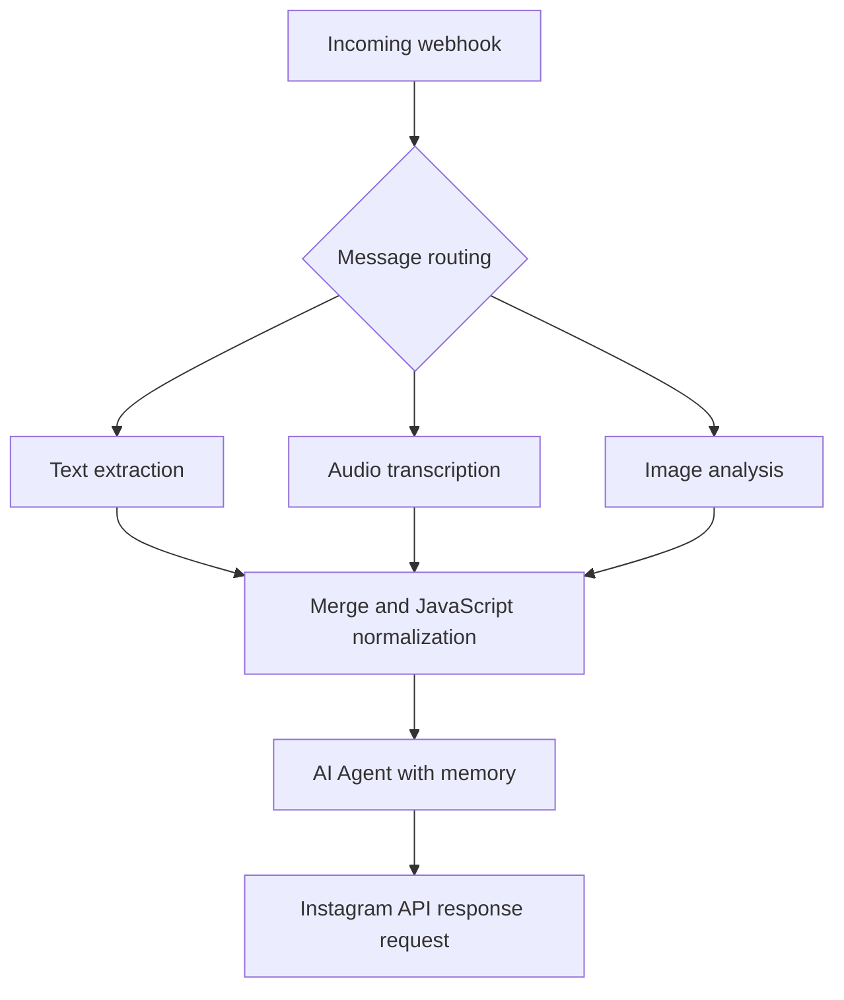

# Multimodal AI Chatbot with n8n

**Portfolio prototype | n8n · JavaScript · OpenAI · Webhooks · Instagram Graph API**

A workflow-based AI assistant prototype designed for a fictional real-estate business. The workflow routes incoming messages by content type, processes text, transcribes audio, analyzes images, and passes a normalized message to an AI agent configured with a sample property catalog and conversational memory.

> **Status:** Prototype, not hosted or verified end-to-end in a live environment. The exported workflow is inactive and requires your own n8n instance, API credentials, webhook configuration, and testing. No client deployment is claimed.

## What the workflow contains

- Webhook handling and message routing with `If` and `Switch` nodes.
- Separate paths for text, audio transcription, and image analysis.
- A `Merge` node and a custom **JavaScript Code** node to normalize message content.
- An OpenAI-powered AI Agent and windowed conversation memory.
- An HTTP request node configured to send text replies through the Instagram Graph API.
- A demonstration real-estate prompt with sample listings and buying, renting, valuation, and selling conversation paths.

## Architecture



*Simplified conceptual diagram; consult `workflow.json` for the actual node connections and webhook verification branch.*

## Custom JavaScript

The `Code in JavaScript` node maps available message fields to a single `text` field used by the agent. Its logic is preserved in [`message-normalizer.js`](message-normalizer.js).

```javascript
let mensaje = '';
if ($json.text) mensaje = $json.text;
if ($json.transcript) mensaje = $json.transcript;
if ($json.content) mensaje = `El usuario envió una imagen. ${$json.content}`;
return [{ json: { text: mensaje } }];
```

**Implementation detail:** when multiple fields exist, later conditions overwrite earlier ones (image > transcript > text). This is not simultaneous concatenation.

## Repository files

- [`workflow.json`](workflow.json) — sanitized n8n workflow export.
- [`message-normalizer.js`](message-normalizer.js) — custom JavaScript extracted from the Code node.
- [`SETUP.md`](SETUP.md) — import, configuration, limitations, and test checklist.

## Running locally

1. Install or access an n8n instance and import `workflow.json`.
2. Supply your own OpenAI and Instagram API credentials in n8n.
3. Replace `REPLACE_WITH_YOUR_TEST_SENDER_ID` and review the `If` condition and webhook setup.
4. Configure the webhook and Meta app according to your environment; review required permissions and callback verification.
5. Test text, audio, and image branches independently, then test agent output and outbound delivery.

See [SETUP.md](SETUP.md) for more details. **Do not commit access tokens, user messages, personal identifiers, or production credentials.**

## About the developer

Created by **Tiago Duchon**, Software Development student (expected graduation: 2027), interested in backend development, API integrations, and AI automation.

[GitHub profile](https://github.com/tiagoduchon)
